# Before / after: stock Rybbit vs rybbit-unlocked

Both columns were captured against the **same database** (same Postgres, ClickHouse and generated traffic), with the
same Playwright script (`scripts/demo/screenshots.mjs`), viewport 1440x900 at 2x. Left: stock upstream
commit. Right: this fork. Pages that stock hides from the navigation are still opened by direct URL and shown as they
render. Generated: 2026-11-25T05:01:23.358Z

## Summary of findings

Test data: 1,144 visits (990 backfilled over 30 days, 154 live), 26 countries, 474 mobile / 305 desktop / 38 tablet
visitors, 32 bot visits, 6 goals and 3 funnels. Every one of the 838 live tracking requests was accepted.

**Not available at all in stock self-hosted, available in the fork**

| Feature | Stock | Fork | Shots |
| --- | --- | --- | --- |
| Turning on Web Vitals collection | no toggle in Site Settings → Tracking, so the tracker never collects LCP/CLS/INP/FCP/TTFB | toggle present | 11 |
| Google Search Console integration | no Integrations tab, no Search Console card on the dashboard | tab present; explains that `GOOGLE_CLIENT_ID`/`GOOGLE_CLIENT_SECRET` are needed | 10, 12 |
| Weekly email reports | no preference in account settings, report job never runs | preference present; reports send once `RESEND_API_KEY` is set | 13 |

**Built into stock but hidden from navigation, shown in the fork**

Pages, Bots, Performance, Query and Dashboards are missing from the stock sidebar and command palette, and the Admin
link is missing from the app rail. The pages themselves were never locked: opened by typing the URL, they render with
the same data in stock (shots 03–08, 14). The fork adds them back to the navigation (shots 01, 02, 15).

| Screen | Before (stock) | After (unlocked fork) |
| --- | --- | --- |
| **01** Main dashboard, full page | 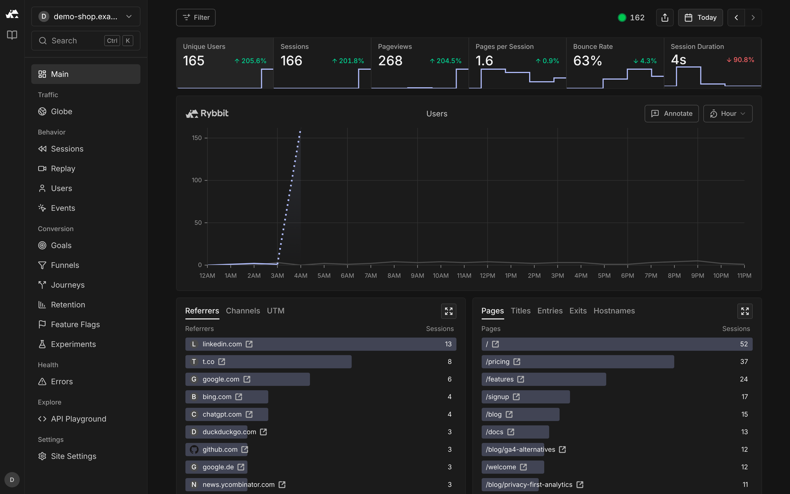<br><sub>final URL: `/1/main?timeMode=day&wellKnown=today&bucket=hour&stat=users`</sub><br><sub>page text: D D demo-shop.example Search Ctrl K Main Traffic Globe Behavior Sessions Replay Users Events Conversion Goals </sub> | 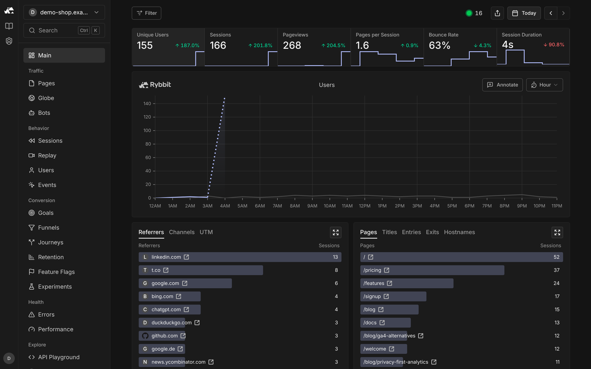<br><sub>final URL: `/1/main?timeMode=day&wellKnown=today&bucket=hour&stat=users`</sub><br><sub>page text: D D demo-shop.example Search Ctrl K Main Traffic Pages Globe Bots Behavior Sessions Replay Users Events Conver</sub> |
| **02** Site sidebar and app rail (which sections are offered) | 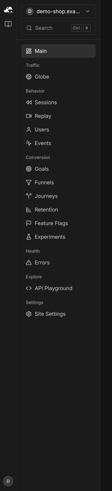<br><sub>final URL: `/1/main?timeMode=day&wellKnown=today&bucket=hour&stat=users`</sub><br><sub>page text: D D demo-shop.example Search Ctrl K Main Traffic Globe Behavior Sessions Replay Users Events Conversion Goals </sub> | 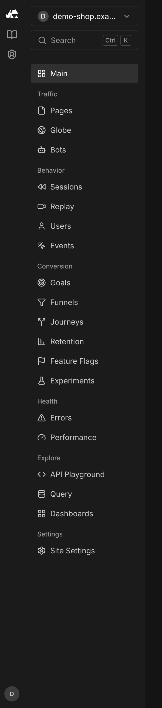<br><sub>final URL: `/1/main?timeMode=day&wellKnown=today&bucket=hour&stat=users`</sub><br><sub>page text: D D demo-shop.example Search Ctrl K Main Traffic Pages Globe Bots Behavior Sessions Replay Users Events Conver</sub> |
| **03** Pages (direct URL) | 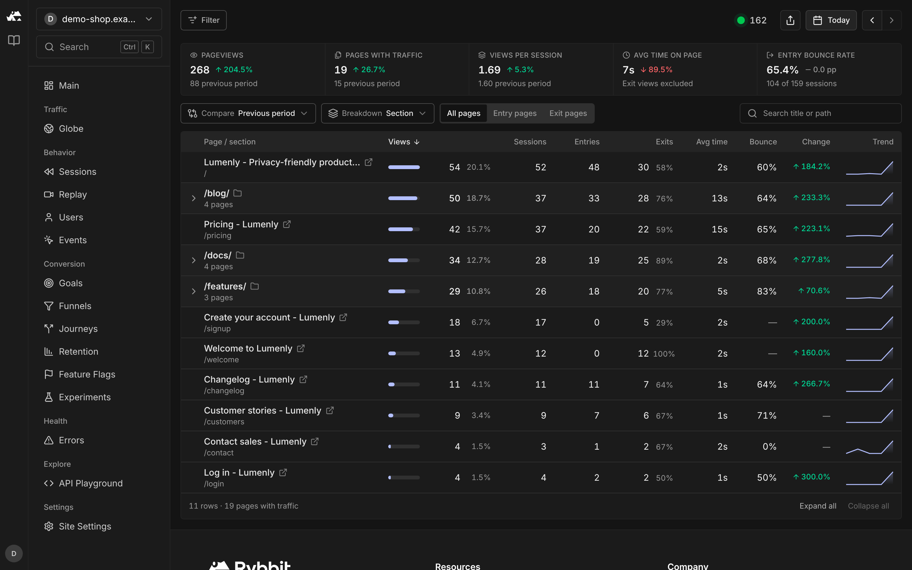<br><sub>final URL: `/1/pages?timeMode=day&wellKnown=today&bucket=hour&stat=users`</sub><br><sub>page text: D D demo-shop.example Search Ctrl K Main Traffic Globe Behavior Sessions Replay Users Events Conversion Goals </sub> | 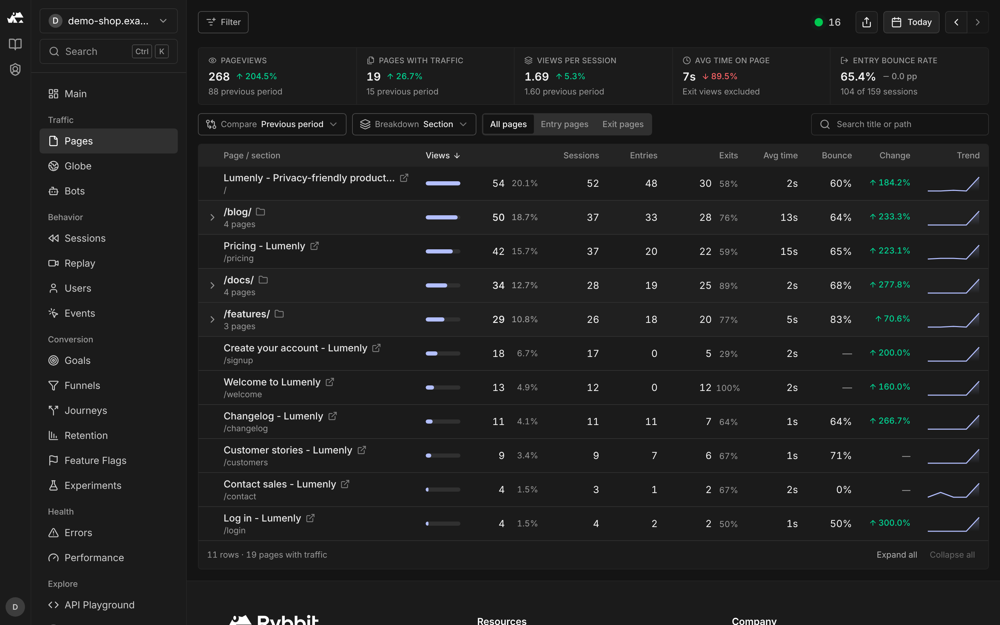<br><sub>final URL: `/1/pages?timeMode=day&wellKnown=today&bucket=hour&stat=users`</sub><br><sub>page text: D D demo-shop.example Search Ctrl K Main Traffic Pages Globe Bots Behavior Sessions Replay Users Events Conver</sub> |
| **04** Bots (direct URL) | 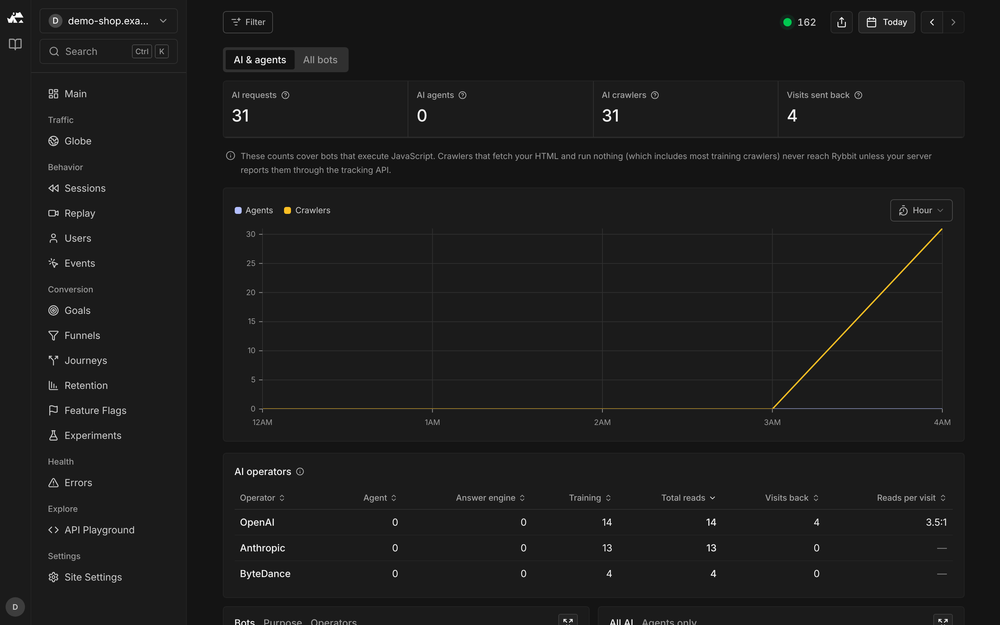<br><sub>final URL: `/1/bots?timeMode=day&wellKnown=today&bucket=hour&stat=users`</sub><br><sub>page text: D D demo-shop.example Search Ctrl K Main Traffic Globe Behavior Sessions Replay Users Events Conversion Goals </sub> | 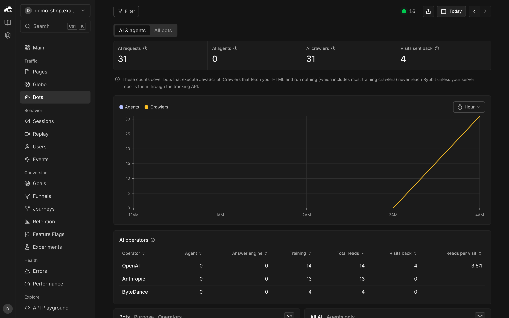<br><sub>final URL: `/1/bots?timeMode=day&wellKnown=today&bucket=hour&stat=users`</sub><br><sub>page text: D D demo-shop.example Search Ctrl K Main Traffic Pages Globe Bots Behavior Sessions Replay Users Events Conver</sub> |
| **05** Performance / Web Vitals (direct URL) | 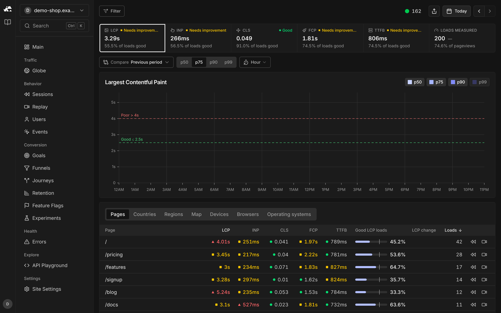<br><sub>final URL: `/1/performance?timeMode=day&wellKnown=today&bucket=hour&stat=users`</sub><br><sub>page text: D D demo-shop.example Search Ctrl K Main Traffic Globe Behavior Sessions Replay Users Events Conversion Goals </sub> | 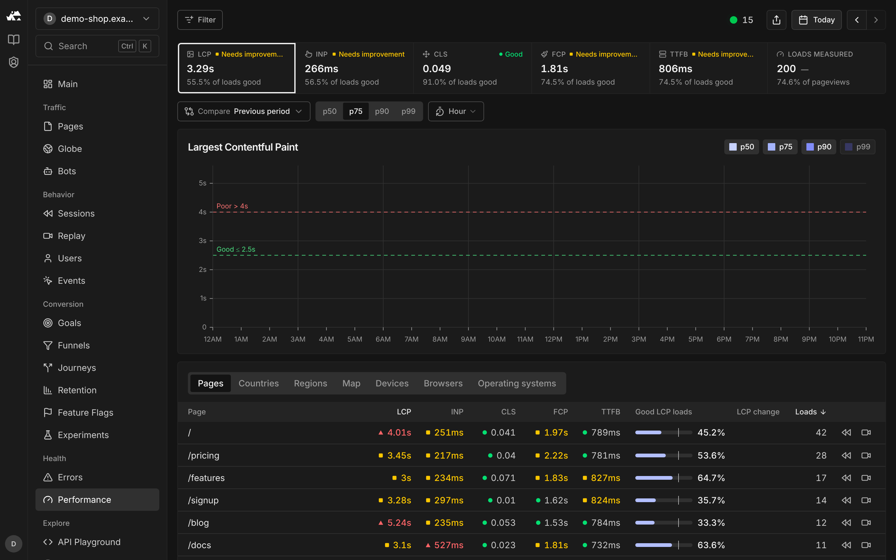<br><sub>final URL: `/1/performance?timeMode=day&wellKnown=today&bucket=hour&stat=users`</sub><br><sub>page text: D D demo-shop.example Search Ctrl K Main Traffic Pages Globe Bots Behavior Sessions Replay Users Events Conver</sub> |
| **06** Query page (direct URL) | 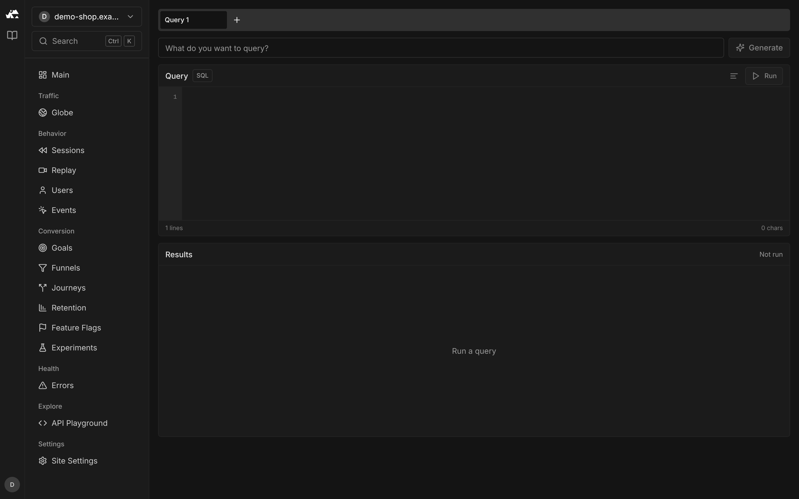<br><sub>final URL: `/1/query`</sub><br><sub>page text: D D demo-shop.example Search Ctrl K Main Traffic Globe Behavior Sessions Replay Users Events Conversion Goals </sub> | 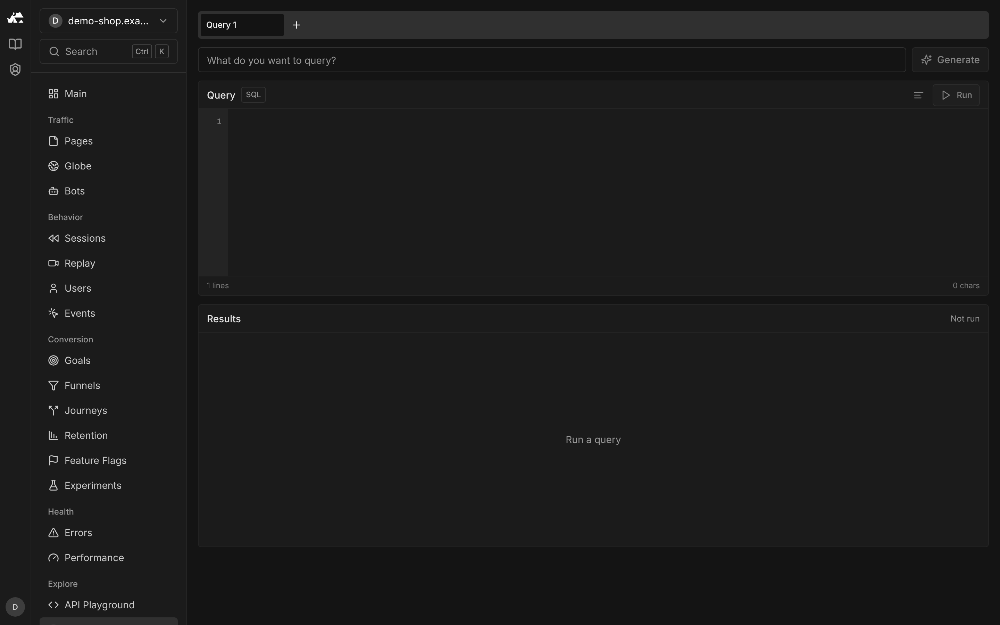<br><sub>final URL: `/1/query`</sub><br><sub>page text: D D demo-shop.example Search Ctrl K Main Traffic Pages Globe Bots Behavior Sessions Replay Users Events Conver</sub> |
| **07** Query page after running a sample SQL query | 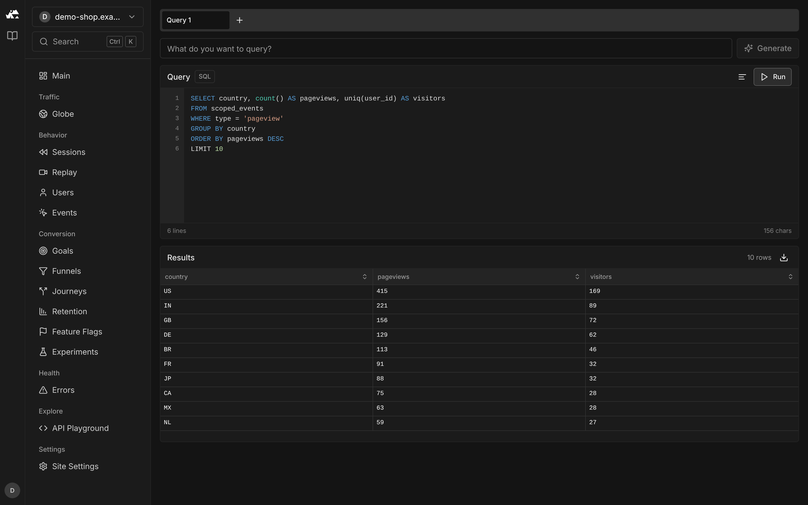<br><sub>final URL: `/1/query`</sub><br><sub>page text: D D demo-shop.example Search Ctrl K Main Traffic Globe Behavior Sessions Replay Users Events Conversion Goals </sub> | 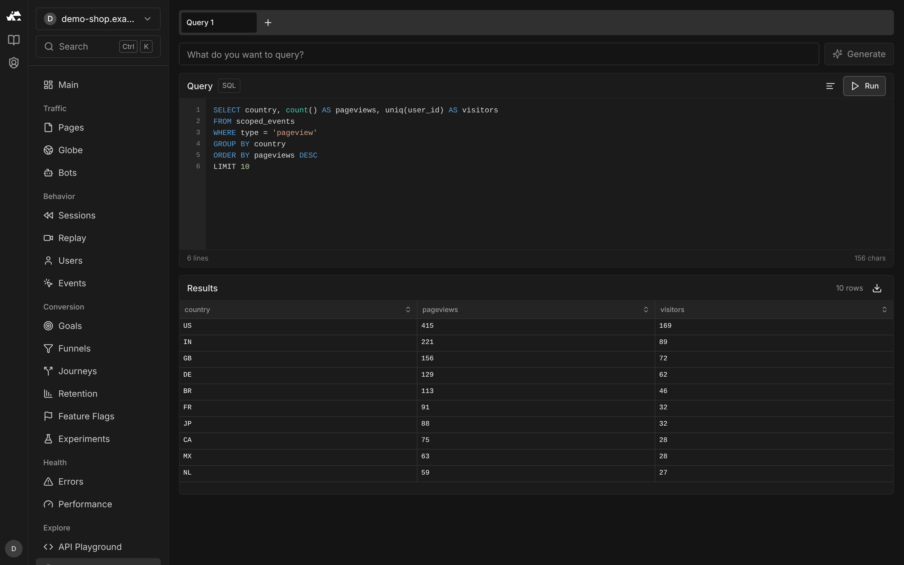<br><sub>final URL: `/1/query`</sub><br><sub>page text: D D demo-shop.example Search Ctrl K Main Traffic Pages Globe Bots Behavior Sessions Replay Users Events Conver</sub> |
| **08** Dashboards (direct URL) | 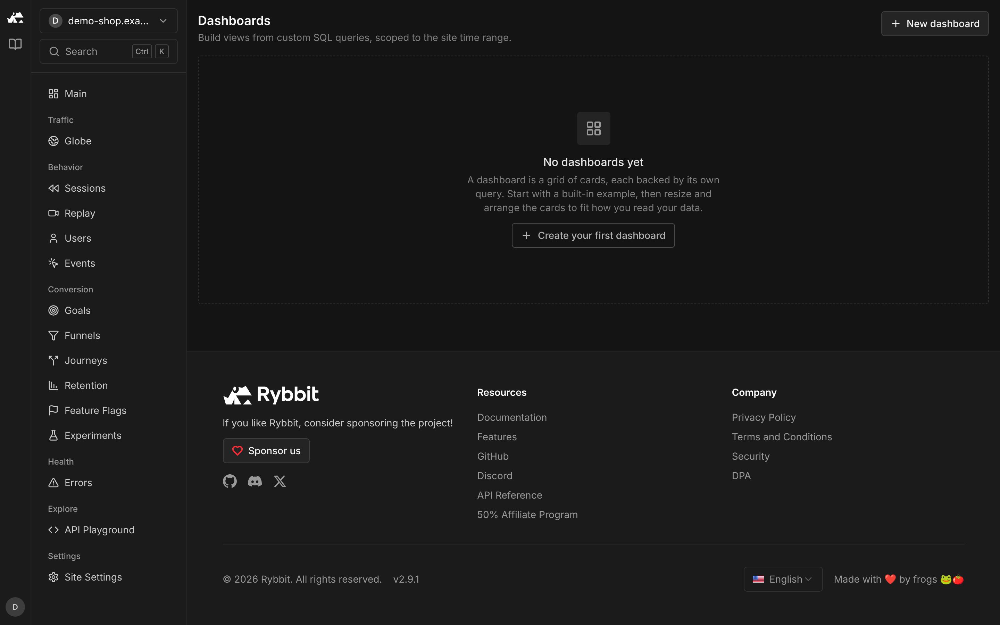<br><sub>final URL: `/1/dashboards?timeMode=day&wellKnown=today&bucket=hour&stat=users`</sub><br><sub>page text: D D demo-shop.example Search Ctrl K Main Traffic Globe Behavior Sessions Replay Users Events Conversion Goals </sub> | 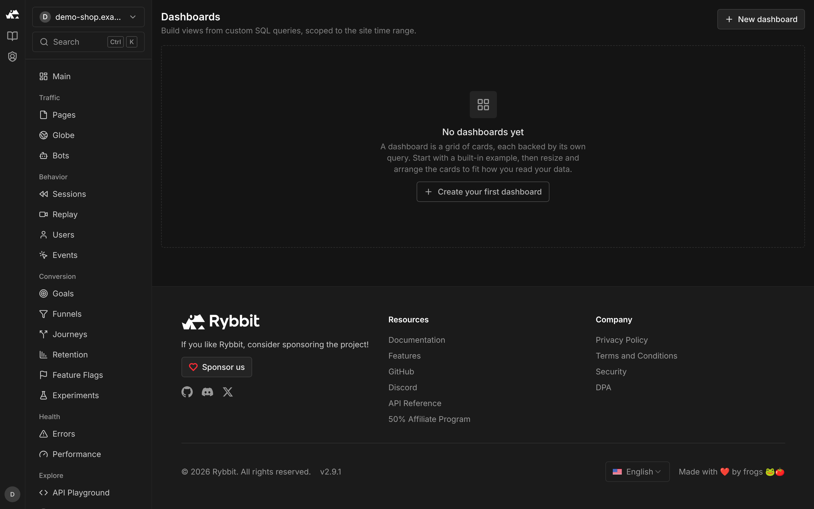<br><sub>final URL: `/1/dashboards?timeMode=day&wellKnown=today&bucket=hour&stat=users`</sub><br><sub>page text: D D demo-shop.example Search Ctrl K Main Traffic Pages Globe Bots Behavior Sessions Replay Users Events Conver</sub> |
| **09** Globe | 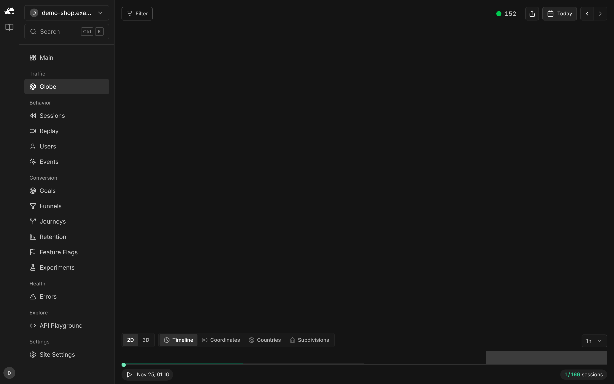<br><sub>final URL: `/1/globe?timeMode=day&wellKnown=today&bucket=hour&stat=users`</sub><br><sub>page text: D D demo-shop.example Search Ctrl K Main Traffic Globe Behavior Sessions Replay Users Events Conversion Goals </sub> | 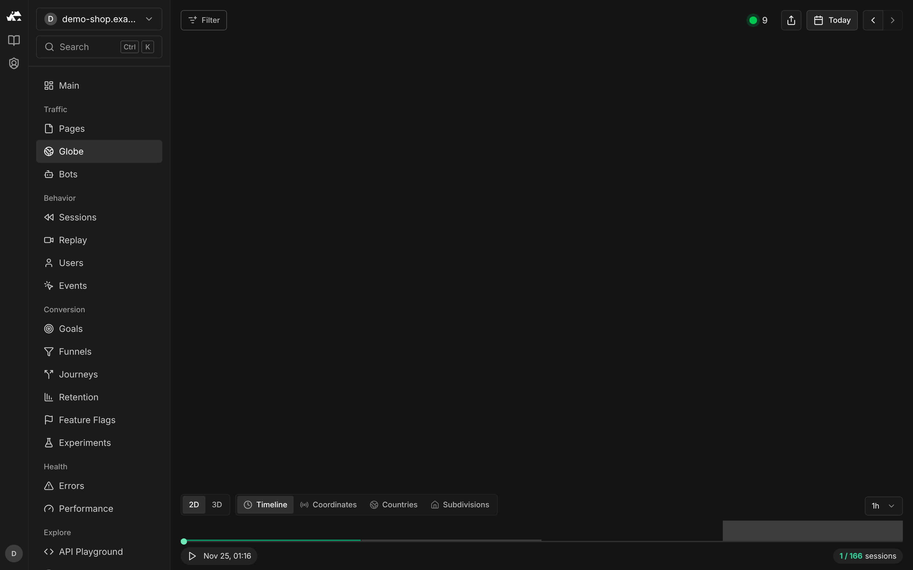<br><sub>final URL: `/1/globe?timeMode=day&wellKnown=today&bucket=hour&stat=users`</sub><br><sub>page text: D D demo-shop.example Search Ctrl K Main Traffic Pages Globe Bots Behavior Sessions Replay Users Events Conver</sub> |
| **10** Site Settings dialog, left rail (list of tabs) | <br><sub>final URL: `/1/main?timeMode=day&wellKnown=today&bucket=hour&stat=users`</sub><br><sub>page text: D D demo-shop.example Search Ctrl K Main Traffic Globe Behavior Sessions Replay Users Events Conversion Goals </sub> | 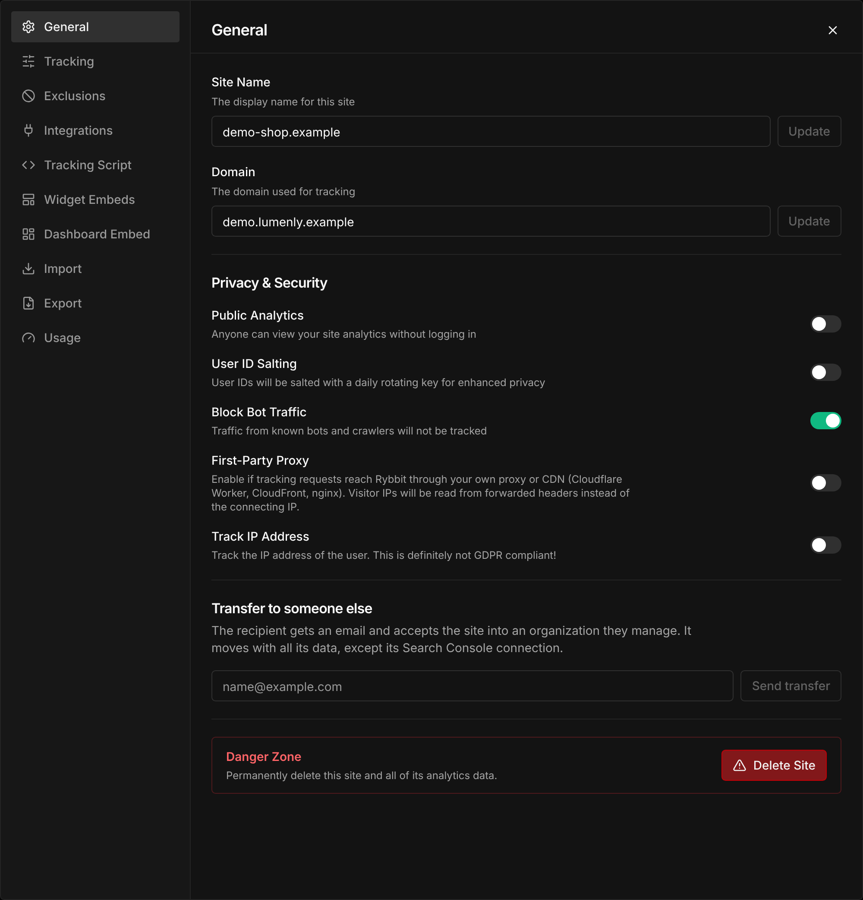<br><sub>final URL: `/1/main?timeMode=day&wellKnown=today&bucket=hour&stat=users`</sub><br><sub>page text: D D demo-shop.example Search Ctrl K Main Traffic Pages Globe Bots Behavior Sessions Replay Users Events Conver</sub> |
| **11** Site Settings, Tracking tab (feature toggles) | 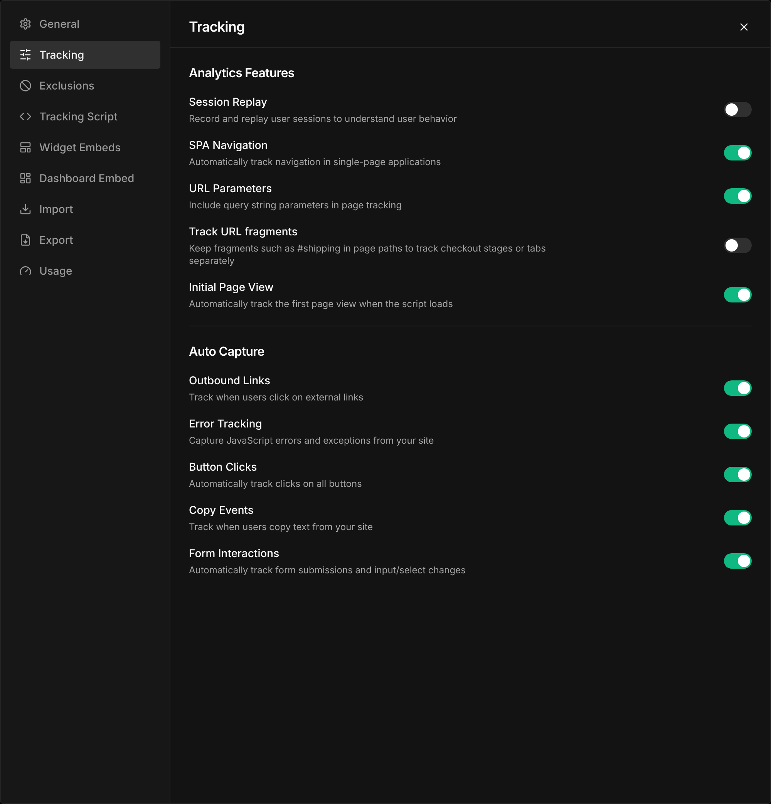<br><sub>final URL: `/1/main?timeMode=day&wellKnown=today&bucket=hour&stat=users`</sub><br><sub>page text: D D demo-shop.example Search Ctrl K Main Traffic Globe Behavior Sessions Replay Users Events Conversion Goals </sub> | 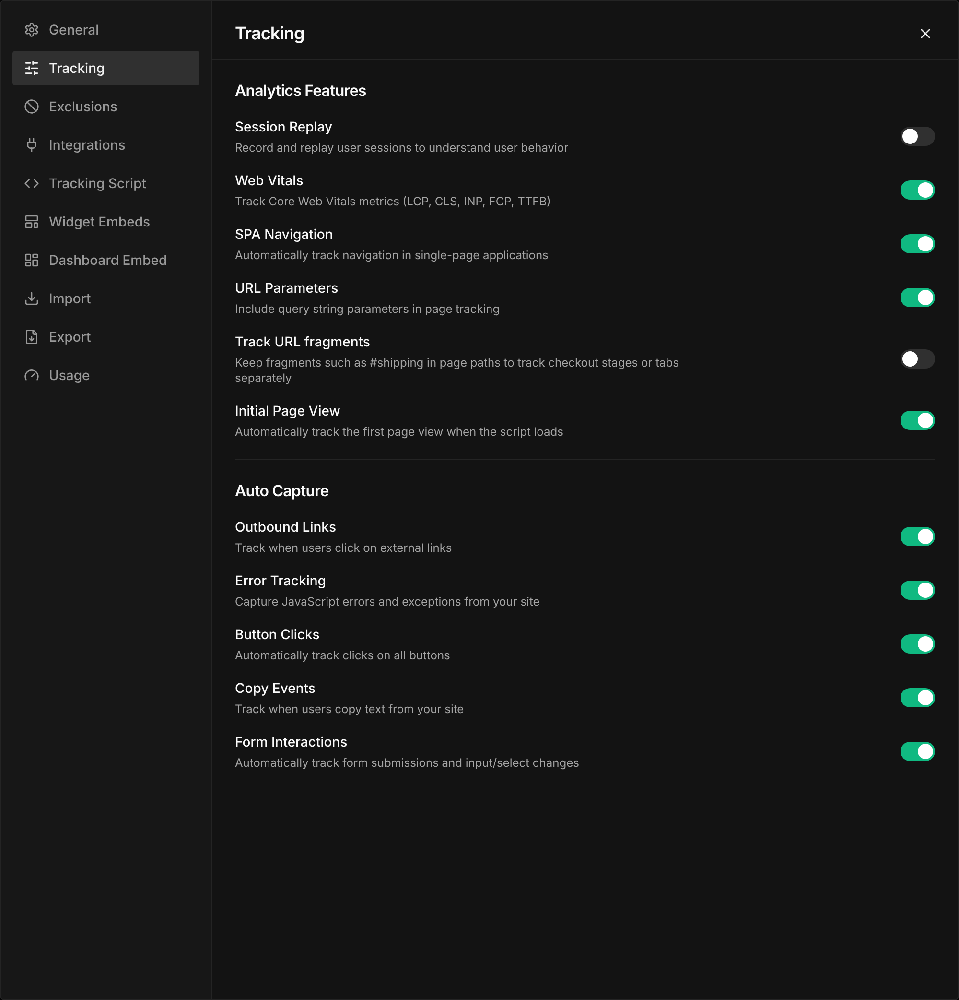<br><sub>final URL: `/1/main?timeMode=day&wellKnown=today&bucket=hour&stat=users`</sub><br><sub>page text: D D demo-shop.example Search Ctrl K Main Traffic Pages Globe Bots Behavior Sessions Replay Users Events Conver</sub> |
| **12** Site Settings, Integrations tab (Search Console) | _absent: no Integrations tab in this build_<br><sub>final URL: `/1/main?timeMode=day&wellKnown=today&bucket=hour&stat=users`</sub> | 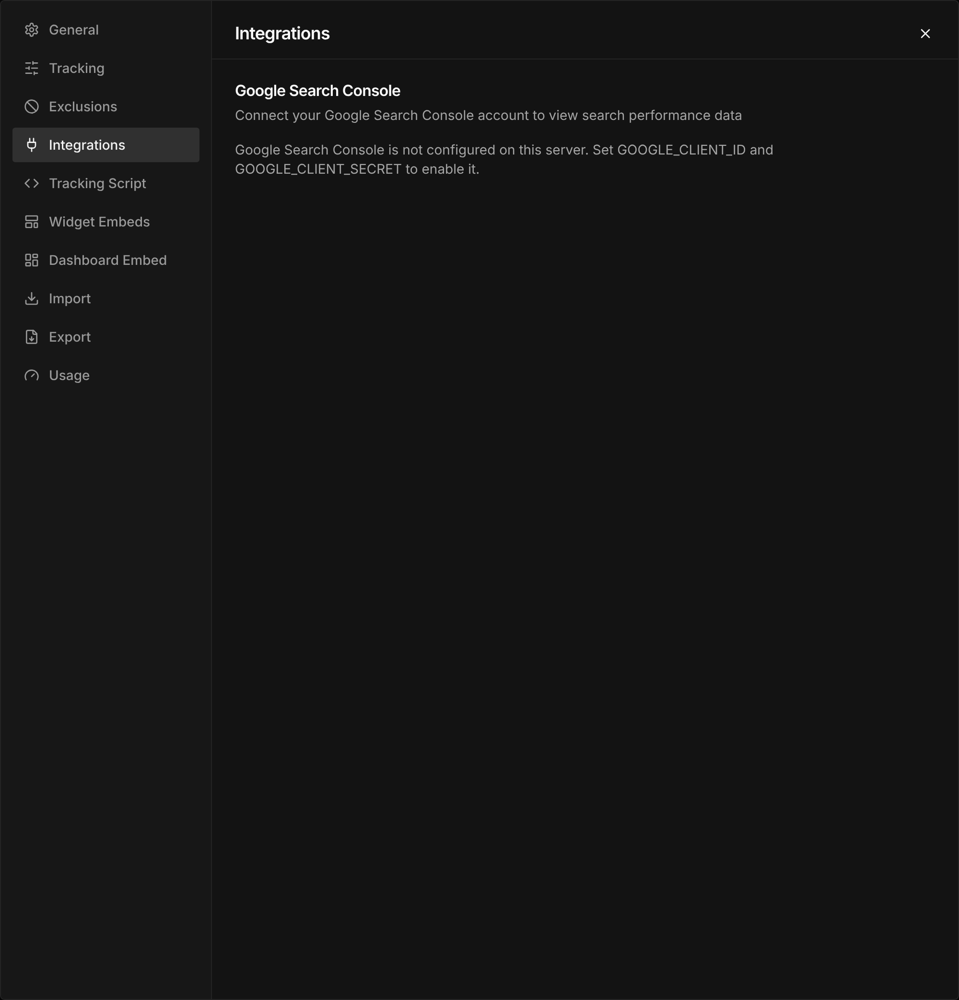<br><sub>final URL: `/1/main?timeMode=day&wellKnown=today&bucket=hour&stat=users`</sub><br><sub>page text: D D demo-shop.example Search Ctrl K Main Traffic Pages Globe Bots Behavior Sessions Replay Users Events Conver</sub> |
| **13** Account settings (Preferences, weekly email reports) | 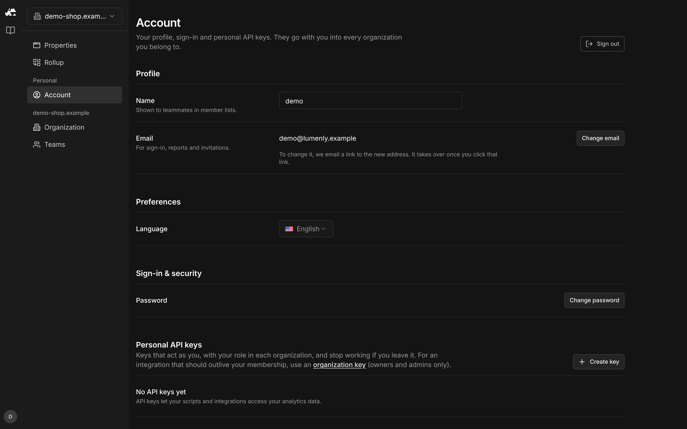<br><sub>final URL: `/settings/account`</sub><br><sub>page text: D demo-shop.example Properties Rollup Personal Account demo-shop.example Organization Teams Account Your profi</sub> | 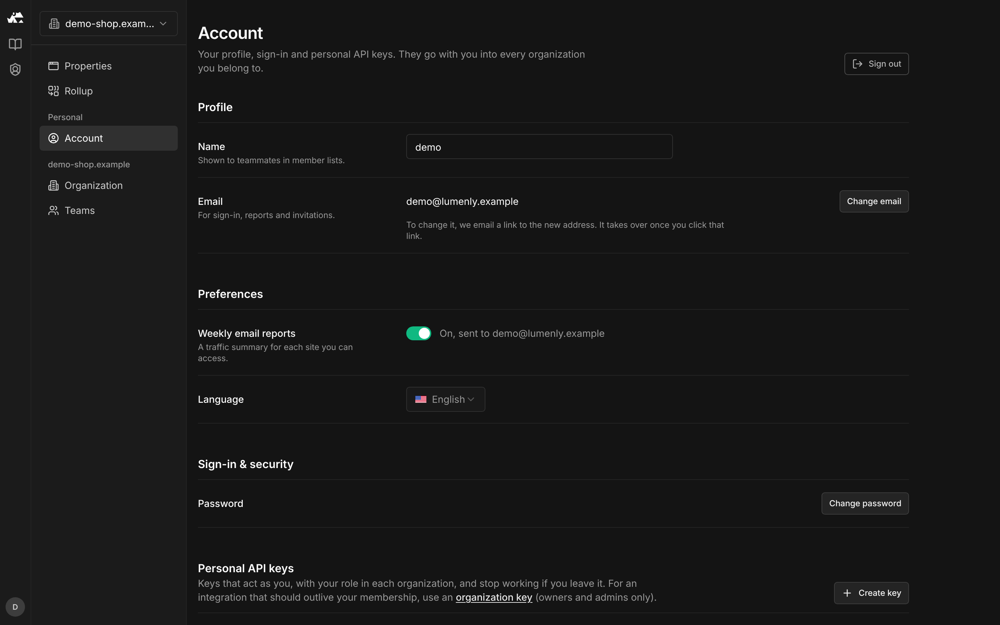<br><sub>final URL: `/settings/account`</sub><br><sub>page text: D demo-shop.example Properties Rollup Personal Account demo-shop.example Organization Teams Account Your profi</sub> |
| **14** Admin area (direct URL) | 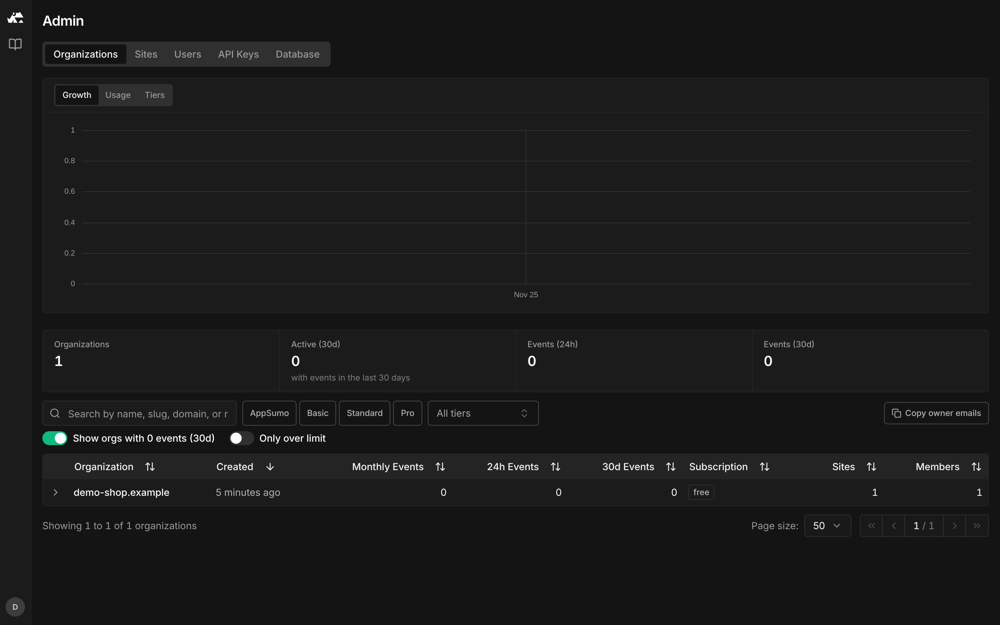<br><sub>final URL: `/admin`</sub><br><sub>page text: D Admin Organizations Sites Users API Keys Database Growth Usage Tiers Nov 25 0 0.2 0.4 0.6 0.8 1 Organization</sub> | 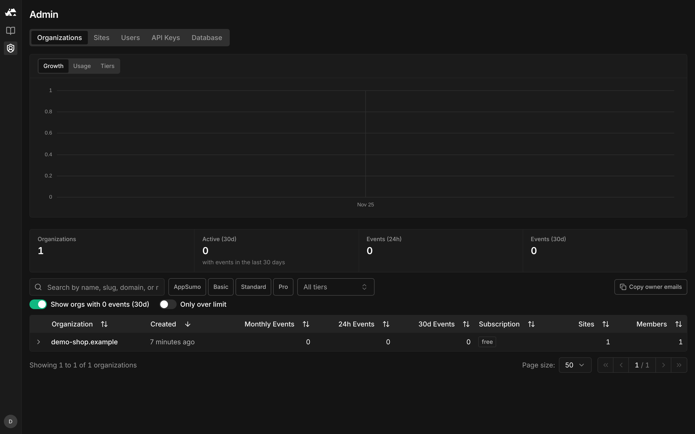<br><sub>final URL: `/admin`</sub><br><sub>page text: D Admin Organizations Sites Users API Keys Database Growth Usage Tiers Nov 25 0 0.2 0.4 0.6 0.8 1 Organization</sub> |
| **15** App rail, bottom: is there an Admin link? | 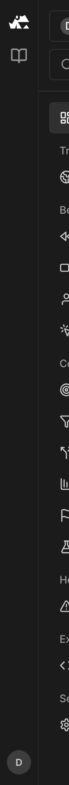<br><sub>final URL: `/1/main?timeMode=day&wellKnown=today&bucket=hour&stat=users`</sub><br><sub>page text: D D demo-shop.example Search Ctrl K Main Traffic Globe Behavior Sessions Replay Users Events Conversion Goals </sub> | 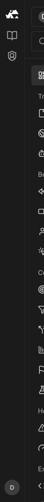<br><sub>final URL: `/1/main?timeMode=day&wellKnown=today&bucket=hour&stat=users`</sub><br><sub>page text: D D demo-shop.example Search Ctrl K Main Traffic Pages Globe Bots Behavior Sessions Replay Users Events Conver</sub> |

## Observations from the run

- Admin link in app rail: before **absent**, after **present**.
- 12 Site Settings, Integrations tab (Search Console): before=absent, after=ok.

## Traffic generator summary

Last lines of `generate-traffic.mjs` output (the same data feeds both columns):

```
created goal "Plan selected"
   created goal "Demo requested"
   created goal "Newsletter subscribed"
   created goal "Pro plan chosen"
   created funnel "Signup flow"
   created funnel "Signup events"
   created funnel "Docs to signup"
Backfill: creating import and uploading 2129 historical rows...
   import 8560c55f-95ac-4afc-96e9-89e7c88b7b8d complete
Sending 137 live visits and 32 bot visits through /api/track...
   ... 188 requests sent (23/169 visits)
   ... 275 requests sent (38/169 visits)
   ... 374 requests sent (63/169 visits)
   ... 448 requests sent (86/169 visits)
   ... 494 requests sent (100/169 visits)
   ... 596 requests sent (128/169 visits)
   ... 701 requests sent (150/169 visits)
   ... 773 requests sent (167/169 visits)
   ... 781 requests sent (168/169 visits)
   ... 789 requests sent (168/169 visits)
Live mode: ~8 visitors/min for 2 min (Ctrl-C to stop)...
   live: 10 visitors started, 815 requests, 0 failed

==== Summary ====
visits: 154 live, 990 backfilled, 32 bot
visitors by country: US=170  IN=89  GB=72  DE=64  BR=46  FR=32  JP=32  CA=28  MX=28  NL=27  ES=26  AU=23  IT=22  ID=18  KR=15  ZA=15  SE=15  SG=15  TR=15  PL=12  AE=11  NG=11  PH=10  VN=9  CH=8  AR=4
devices:  mobile=474  desktop=305  tablet=38
browsers: Mobile Chrome=234  Chrome=218  Mobile Safari=163  Samsung Internet=71  Firefox=56  Safari=29  Edge=26  Mobile Firefox=20
os:       Android=325  iOS=187  Windows=173  macOS=96  Linux=20  Ubuntu=16
languages:en-US=225  en-GB=78  en-IN=62  de-DE=55  pt-BR=40  fr-FR=29  ja-JP=28  es-ES=24
sources:  direct=466  google=197  newsletter=60  linkedin=45  twitter=42  github=41  reddit=36  bing=35  google_cpc=34  hackernews=34  duckduckgo=29  chatgpt=26  facebook=26  youtube=26  linkedin_paid=19  medium=10  twitter_paid=9  perplexity=5  producthunt=4  bot:Googlebot=4
events by type (planned, all paths): pageview=1910  performance=1402  custom_event=551  button_click=199  input_change=180  bot-pageview=133  outbound=122  form_submit=87  identify=74  copy=54  error=51
identified users planned: 68
HTTP: 838 requests (track 764, identify 74); accepted 838, accepted-but-skipped 0, failed 0
status codes: 200=838
history import: 2129 rows in 2 batch(es)
live events sent by type: pageview=392  performance=200  identify=74  custom_event=73  input_change=30  button_click=29  outbound=13  form_submit=13  error=7  copy=7

Done. Events appear in the dashboard after the server's batch flush (a few seconds).
```

Note: the Realtime count reflects the `--live` phase and decays after a few minutes, so it can differ between the two captures even though the stored history is identical.
